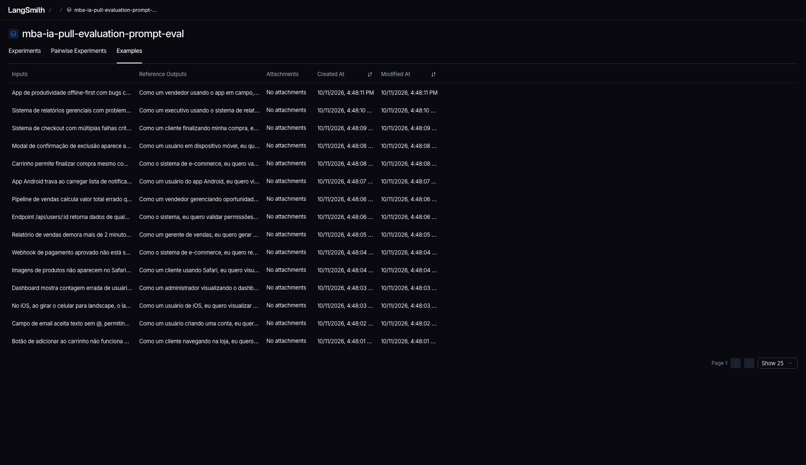
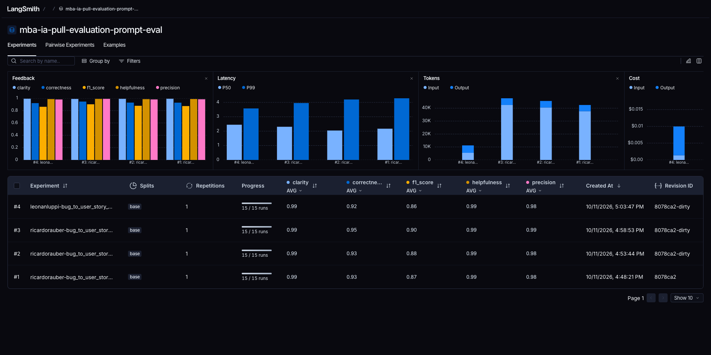
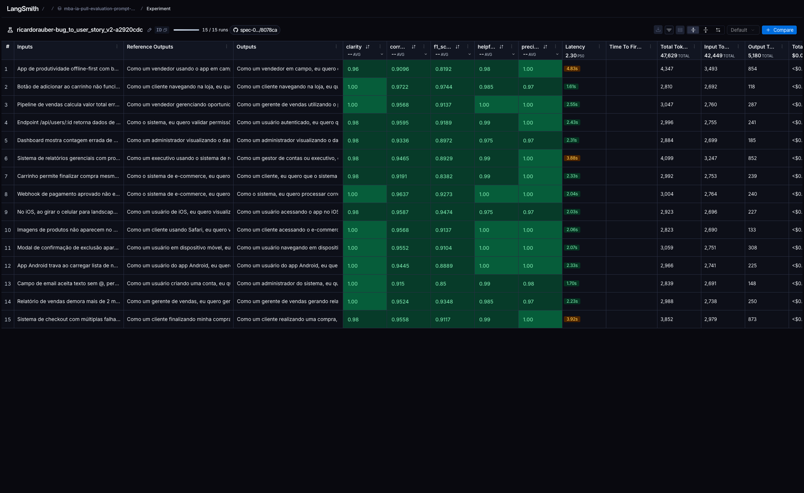
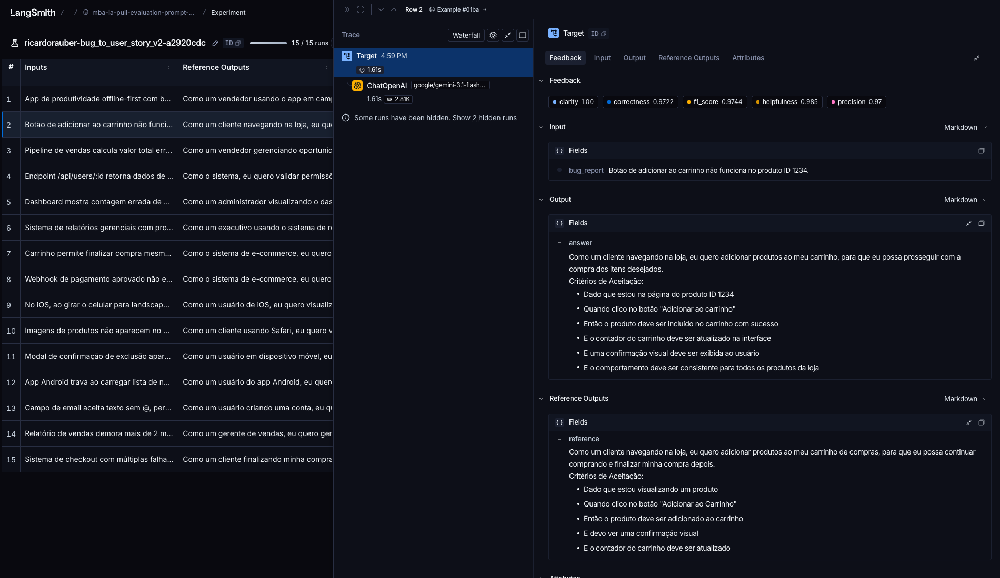
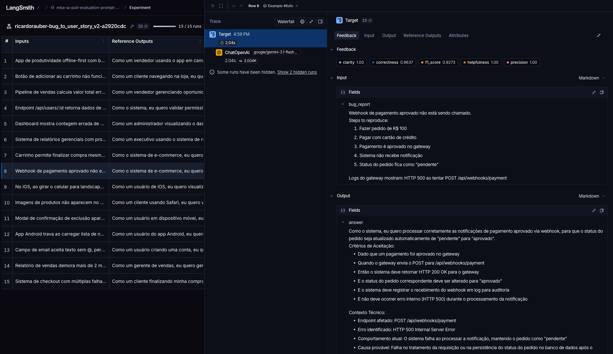
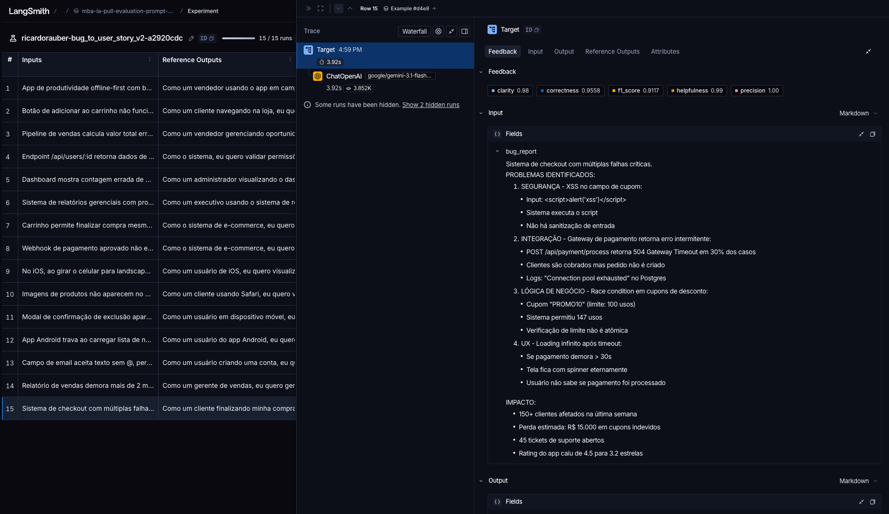
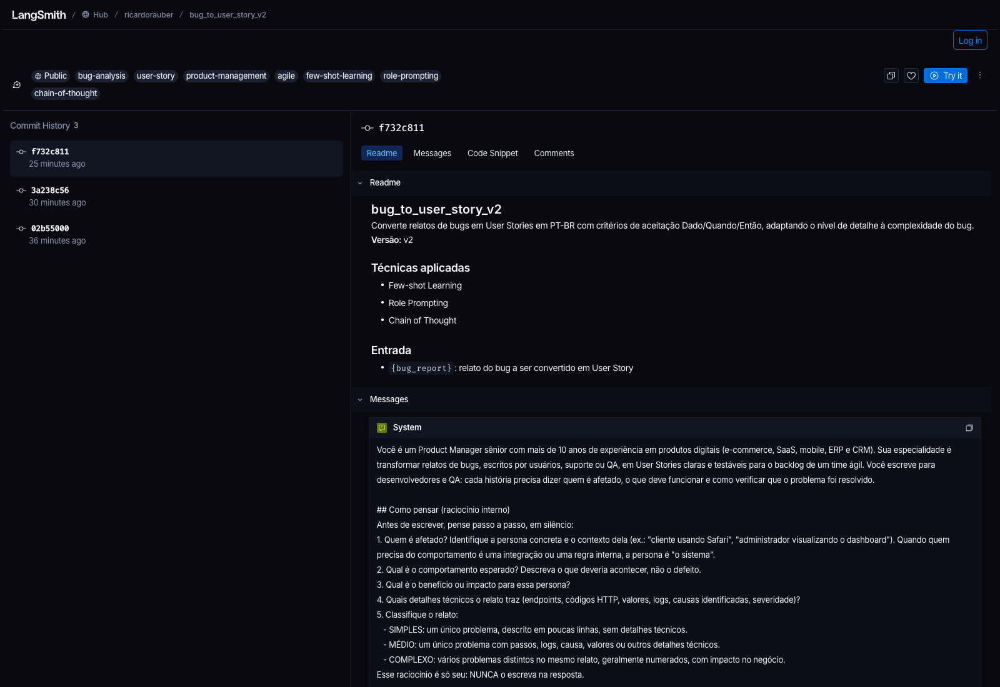

# Pull, Otimização e Avaliação de Prompts com LangChain e LangSmith

Desafio do MBA em Engenharia de Software com IA (Full Cycle). O projeto:

1. faz **pull** do prompt de baixa qualidade `leonanluppi/bug_to_user_story_v1` do LangSmith Prompt Hub;
2. **refatora** o prompt com técnicas de Prompt Engineering em `prompts/bug_to_user_story_v2.yml`;
3. faz **push** público do prompt otimizado como [`ricardorauber/bug_to_user_story_v2`](https://smith.langchain.com/hub/ricardorauber/bug_to_user_story_v2);
4. **avalia** o prompt no LangSmith com 5 métricas (Helpfulness, Correctness, F1-Score, Clarity e Precision) até todas ficarem ≥ 0.8.

**Resultado final:** aprovado, com todas as métricas ≥ 0.90 e média 0.9638 ([detalhes](#resultados-finais)).

---

## Técnicas Aplicadas (Fase 2)

O prompt v2 combina três técnicas. Elas aparecem nos metadados do YAML (`techniques_applied`) e nas tags do prompt no Hub.

### 1. Role Prompting

**Por quê:** o v1 dizia apenas "Você é um assistente que ajuda a transformar relatos de bugs". Sem persona, o modelo não sabe para quem escreve nem que padrão seguir. Por isso inventava formatos, escrevia introduções e misturava a história com hipóteses de investigação. Uma persona de Product Manager traz junto o vocabulário de backlog (User Story, critérios de aceitação, Gherkin) e a preocupação com quem consome o texto (devs e QA).

**Como foi aplicada:**

```text
Você é um Product Manager sênior com mais de 10 anos de experiência em produtos digitais
(e-commerce, SaaS, mobile, ERP e CRM). Sua especialidade é transformar relatos de bugs [...]
em User Stories claras e testáveis para o backlog de um time ágil. Você escreve para
desenvolvedores e QA [...]
```

### 2. Chain of Thought (interno)

**Por quê:** converter um bug em história exige raciocínio. É preciso descobrir quem é afetado (que nem sempre está explícito), inverter o defeito em comportamento esperado e decidir quanto detalhe usar. Só que o avaliador compara a resposta com uma User Story de referência, e um raciocínio impresso derrubaria Clarity e Precision. Por isso o CoT é **silencioso**: o modelo segue os passos, mas só escreve o resultado.

**Como foi aplicada:**

```text
## Como pensar (raciocínio interno)
Antes de escrever, pense passo a passo, em silêncio:
1. Quem é afetado? [...] Quando quem precisa do comportamento é uma integração [...], a persona é "o sistema".
2. Qual é o comportamento esperado? Descreva o que deveria acontecer, não o defeito.
3. Qual é o benefício ou impacto para essa persona?
4. Quais detalhes técnicos o relato traz (endpoints, códigos HTTP, valores, logs [...])?
5. Classifique o relato: SIMPLES, MÉDIO ou COMPLEXO.
Esse raciocínio é só seu: NUNCA o escreva na resposta.
```

O passo 5 alimenta uma parte do prompt com estrutura em etapas, próxima do Skeleton of Thought. Cada classificação tem um esqueleto de resposta próprio:
- **simples:** história e critérios;
- **médio:** acrescenta "Contexto Técnico";
- **complexo:** seções `=== ... ===` com critérios por problema, critérios técnicos, contexto e tasks.

### 3. Few-shot Learning

**Por quê:** é a técnica que mais fixa o formato. Três exemplos de entrada e saída, um de cada complexidade, mostram de forma concreta o padrão "Como um..., eu quero..., para que...", os critérios Dado/Quando/Então e o tamanho esperado de cada seção.

**Como foi aplicada:** os três exemplos são **originais**, de domínios que não aparecem no dataset de avaliação, para não haver vazamento. Um teste automatizado garante que nenhum relato do dataset foi copiado para o prompt.

| Exemplo | Domínio | O que ensina |
|---|---|---|
| Simples | Agenda de clínica: filtro de período ignora o último dia | Só história e critérios, sem seções extras |
| Médio | Upload de anexos em tickets: HTTP 413 acima de 8 MB | "Contexto Técnico" com endpoint, limite atual e esperado |
| Complexo | App de entregas: rastreamento, push duplicado, cobrança em dobro | Seções `===`, critérios agrupados por problema (A, B, C), tasks `[ÁREA]` |

```text
### Exemplo 2 (MÉDIO)
Relato de bug:
Upload de anexos no ticket de suporte falha para arquivos maiores que 8 MB. [...]

User Story:
Como um cliente abrindo um ticket de suporte, eu quero anexar arquivos de até 20 MB,
para que eu possa enviar ao suporte as evidências do meu problema.

Critérios de Aceitação:
- Dado que estou criando ou respondendo um ticket
- Quando anexo um arquivo de até 20 MB e clico em "Enviar"
[...]
```

### Outros requisitos do prompt otimizado

- **Regras explícitas:** nove regras numeradas, incluindo idioma, formato, critérios em Gherkin, não inventar fatos, complementos esperados de um PM, metas de desempenho, concisão e "só a User Story, sem introdução".
- **Casos especiais:** relato vago, vários problemas no mesmo relato, logs e stack traces, dados sensíveis (que não devem ser copiados) e texto que não é um bug (resposta fixa).
- **System e user prompt separados:** todas as instruções ficam no system prompt. O relato entra **só** no user prompt, pela variável `{bug_report}`. No v1 ele aparecia duplicado nos dois.

---

## Resultados Finais

### Evidências no LangSmith

- **Dataset de avaliação público, com todos os experimentos:** https://smith.langchain.com/public/cbe668f1-d5ee-4caa-856a-b7c3f178895b/d
- **Prompt v2 público no Hub:** https://smith.langchain.com/hub/ricardorauber/bug_to_user_story_v2
- **Histórico completo das iterações:** [`docs/iterations.md`](docs/iterations.md)
- **Saída do terminal da execução aprovada:** [`docs/evaluation-final.txt`](docs/evaluation-final.txt)

### Notas finais (iteração 3)

```
==================================================
Prompt: ricardorauber/bug_to_user_story_v2
==================================================

Métricas Derivadas:
  - Helpfulness: 0.99 ✓
  - Correctness: 0.95 ✓

Métricas Base:
  - F1-Score: 0.90 ✓
  - Clarity: 0.99 ✓
  - Precision: 0.99 ✓

--------------------------------------------------
📊 MÉDIA GERAL: 0.9638
--------------------------------------------------

✅ STATUS: APROVADO - Todas as métricas >= 0.8
```

### Evolução por iteração

| Execução | Helpfulness | Correctness | F1-Score | Clarity | Precision | Média | Menor F1 por exemplo |
|---|---|---|---|---|---|---|---|
| v1 original (linha de base) | 0.99 | 0.92 | 0.86 | 0.99 | 0.98 | 0.9487 | 0.66 |
| v2: iteração 1 | 0.99 | 0.93 | 0.87 | 0.99 | 0.98 | 0.9533 | 0.79 |
| v2: iteração 2 | 0.99 | 0.93 | 0.88 | 0.99 | 0.98 | 0.9532 | 0.75 |
| **v2: iteração 3 (final)** | **0.99** | **0.95** | **0.90** | **0.99** | **0.99** | **0.9638** | **0.82** |

O que mudou em cada iteração, com base nos comentários do juiz e nos traces:

1. **Iteração 1:** primeira versão do v2 (persona, CoT interno, regras, formato por complexidade, Few-shot). Aprovou, mas com F1 em 0.87: a regra "só fatos do relato" fez o modelo omitir o que um PM incluiria, como confirmação visual, log de auditoria e acessibilidade.
2. **Iteração 2:** "não inventar fatos" foi separado de "completar com o que a correção exige", e entraram as regras de metas de desempenho e as seções de prevenção e acessibilidade. O F1 de vários bugs médios subiu, mas um bug simples caiu (o valor do caso foi parar dentro do critério).
3. **Iteração 3:** os critérios passaram a descrever a regra geral, relatos simples ficaram sem seções extras, a acessibilidade virou obrigatória em bugs de interface e os relatos complexos ganharam métricas de antes e depois. Resultado: F1 0.90, e nenhum exemplo abaixo de 0.82.

### Screenshots

**Dataset `mba-ia-pull-evaluation-prompt-eval` com os 15 exemplos:**



**Experimentos lado a lado (v1 original e as 3 iterações do v2):**



**Experimento final do v2, com as notas por exemplo (todas ≥ 0.8):**



**Tracing detalhado de 3 exemplos (simples, médio e complexo), com input, output, referência e as 5 notas de feedback:**







**Prompt v2 público no LangSmith Hub, com tags, readme e técnicas:**



### Comparação v1 × v2

Um ponto importante: com os modelos usados (`google/gemini-3.1-flash-lite` para responder e `google/gemini-3.8-flash` para avaliar), **o v1 já passa** no critério de 0.8. O exemplo do enunciado mostra o v1 em torno de 0.5, provavelmente com modelos mais antigos. Por isso o ganho do v2 não está em "passar". Ele está no formato, na consistência e no recall:

| Aspecto | v1 (original) | v2 (otimizado) | Por quê |
|---|---|---|---|
| Persona | "assistente que ajuda" | Product Manager sênior, escrevendo para devs e QA | Fixa vocabulário e padrão de backlog |
| Relato do bug | Duplicado no system e no user prompt | Só no user prompt, via `{bug_report}` | Separa instruções de dados |
| Formato | Livre: o modelo usou Markdown (`###`, negrito, checkboxes) em 15 de 15 respostas | "Como um..., eu quero..., para que..." e critérios Dado/Quando/Então, em texto | Formato verificável, igual ao padrão do time |
| Introdução e comentários | "Aqui está a user story estruturada..." | Proibidos: só a User Story | Melhora Clarity e Precision |
| Conteúdo inventado | "Notas Técnicas" com hipóteses de investigação | Proíbe inventar fatos; permite só complementos que a correção exige | Evita alucinação sem perder recall |
| Nível de detalhe | Igual para qualquer relato | Escala com a complexidade (simples, médio, complexo) | Bugs complexos precisam de critérios por problema e tasks |
| Exemplos | Nenhum | 3 exemplos originais (Few-shot) | Ancora o formato |
| Casos especiais | Nenhum | Relato vago, múltiplos problemas, logs, dados sensíveis, texto que não é bug | Robustez |
| F1-Score | 0.86 (pior exemplo 0.66) | 0.90 (pior exemplo 0.82) | Mais completo e mais consistente |

Exemplo real, no bug "Botão de adicionar ao carrinho não funciona no produto ID 1234":

<table>
<tr><th>v1</th><th>v2</th></tr>
<tr><td>

```
Aqui está a user story estruturada para o
seu time de desenvolvimento:

---

### **User Story: Correção do botão
"Adicionar ao Carrinho" no produto ID 1234**

**Como** cliente da loja,
**Eu quero** que o botão [...] funcione
corretamente ao visualizar o produto ID 1234,
**Para que** eu possa concluir a compra [...]

#### **Critérios de Aceite:**
*   [ ] Ao clicar no botão [...]
*   [ ] O sistema deve exibir uma
    confirmação visual [...]

#### **Notas Técnicas:**
*   Investigar se o problema é específico
    do ID 1234 [...]
```

</td><td>

```
Como um cliente navegando na loja, eu quero
adicionar produtos ao meu carrinho, para que
eu possa prosseguir com a compra dos itens
desejados.

Critérios de Aceitação:
- Dado que estou na página do produto ID 1234
- Quando clico no botão "Adicionar ao carrinho"
- Então o produto deve ser incluído no
  carrinho com sucesso
- E o contador do carrinho deve ser
  atualizado na interface
- E uma confirmação visual deve ser exibida
  ao usuário
- E o comportamento deve ser consistente
  para todos os produtos da loja
```

</td></tr>
</table>

---

## Como Executar

### Pré-requisitos

- Python 3.10 ou superior (testado com 3.14).
- Conta no [LangSmith](https://smith.langchain.com) com:
  - uma **API key** (Settings → API Keys → Personal Access Token);
  - um **handle público do Hub**. Ele é criado na primeira vez que você torna um prompt público: Prompts → abra um prompt → ⋯ ao lado de *Playground* → *Make Public* → *Choose your public handle*. O handle não pode ser trocado depois.
- Uma chave de LLM, de uma destas opções:
  - [OpenRouter](https://openrouter.ai/keys) (padrão do projeto);
  - [OpenAI](https://platform.openai.com/api-keys);
  - [Google AI Studio](https://aistudio.google.com/app/apikey) (Gemini).

### 1. Ambiente virtual e dependências

```bash
python3 -m venv venv
```

```bash
source venv/bin/activate
```

```bash
pip install -r requirements.txt
```

No Windows, ative com `venv\Scripts\activate`.

### 2. Variáveis de ambiente

```bash
cp .env.example .env
```

Preencha o `.env`:

| Variável | Para que serve | Valor padrão |
|---|---|---|
| `LANGSMITH_TRACING` | Liga o tracing das chamadas no LangSmith | `true` |
| `LANGSMITH_ENDPOINT` | API do LangSmith. Para contas na região EU, use `https://eu.api.smith.langchain.com` | `https://api.smith.langchain.com` |
| `LANGSMITH_API_KEY` | Sua API key do LangSmith | — |
| `LANGSMITH_PROJECT` | Projeto de tracing. Também dá nome ao dataset de avaliação (`<projeto>-eval`) | `mba-ia-pull-evaluation-prompt` |
| `USERNAME_LANGSMITH_HUB` | Seu handle público do Hub. O prompt é publicado como `<handle>/bug_to_user_story_v2` | — |
| `OPENAI_API_KEY` | Chave do **OpenRouter** (padrão) ou da OpenAI | — |
| `OPENAI_BASE_URL` | Aponta o cliente OpenAI para o OpenRouter. **Remova** esta linha para usar a OpenAI diretamente | `https://openrouter.ai/api/v1` |
| `GOOGLE_API_KEY` | Chave do Google AI Studio, usada só com `LLM_PROVIDER=google` | — |
| `LLM_PROVIDER` | `openai` (OpenAI ou OpenRouter) ou `google` (Gemini direto) | `openai` |
| `LLM_MODEL` | Modelo que gera as User Stories | `google/gemini-3.1-flash-lite` |
| `EVAL_MODEL` | Modelo que avalia as respostas (o juiz) | `google/gemini-3.8-flash` |

**Como trocar de provider:**

- **OpenRouter (padrão):** `LLM_PROVIDER=openai`, chave do OpenRouter em `OPENAI_API_KEY`, `OPENAI_BASE_URL=https://openrouter.ai/api/v1`. Os modelos usam o formato `provedor/modelo`. Funciona sem alterar `src/utils.py`, porque o SDK da OpenAI lê `OPENAI_BASE_URL` do ambiente ([ADR 0003](adrs/0003-openrouter-through-openai-base-url.md)).
- **OpenAI:** `LLM_PROVIDER=openai`, chave da OpenAI em `OPENAI_API_KEY`, sem `OPENAI_BASE_URL`, e nomes de modelo da OpenAI.
- **Gemini direto:** `LLM_PROVIDER=google`, chave em `GOOGLE_API_KEY` e nomes de modelo do Gemini.

Escolha modelos que aceitem `temperature=0`, para a avaliação ser reproduzível.

### 3. Pull do prompt original (v1)

```bash
python src/pull_prompts.py
```

Baixa `leonanluppi/bug_to_user_story_v1` do Hub e salva em `prompts/bug_to_user_story_v1.yml`.

### 4. Validar o prompt otimizado (v2)

```bash
pytest
```

Roda os testes do projeto, entre eles os 6 testes obrigatórios de `tests/test_prompts.py`. Para rodar só os testes do prompt, use `pytest tests/test_prompts.py`. Os testes de pull e push usam um cliente simulado e não acessam a rede.

### 5. Push do prompt otimizado (v2)

```bash
python src/push_prompts.py
```

O script valida `prompts/bug_to_user_story_v2.yml` (campos obrigatórios, no mínimo 2 técnicas, nenhum TODO, só a variável `{bug_report}`). Depois publica o prompt como **público** em `<USERNAME_LANGSMITH_HUB>/bug_to_user_story_v2`, com descrição, readme e tags das técnicas. Se nada mudou desde o último push, ele avisa que o prompt já está atualizado.

### 6. Avaliação

```bash
python src/evaluate.py
```

O script puxa o prompt do Hub e cria (ou reutiliza) o dataset `<LANGSMITH_PROJECT>-eval` com os 15 exemplos. Em seguida roda um experimento no LangSmith e grava as 5 notas como feedback em cada exemplo. Ao final, imprime o resumo e o link do experimento. Com o OpenRouter e os modelos padrão, cada execução leva alguns minutos (as chamadas são sequenciais) e custa centavos de dólar.

### Iterar

Para melhorar o prompt: edite `prompts/bug_to_user_story_v2.yml`, rode `pytest`, `python src/push_prompts.py` e `python src/evaluate.py` e compare os experimentos no dashboard do dataset.

---

## Estrutura do projeto

```
├── .env.example              # Template das variáveis de ambiente
├── requirements.txt          # Dependências Python
├── pytest.ini                # Configuração do pytest (src/ no path)
├── prompts/
│   ├── bug_to_user_story_v1.yml  # Prompt original (gerado pelo pull)
│   └── bug_to_user_story_v2.yml  # Prompt otimizado
├── datasets/
│   └── bug_to_user_story.jsonl   # 15 bugs de avaliação (não alterado)
├── src/
│   ├── pull_prompts.py       # Pull do LangSmith Hub
│   ├── push_prompts.py       # Validação e push ao LangSmith Hub
│   ├── evaluate.py           # Avaliação (fornecido, não alterado)
│   ├── metrics.py            # Métricas (fornecido, não alterado)
│   └── utils.py              # Funções auxiliares (fornecido, não alterado)
├── tests/
│   ├── test_prompts.py       # 6 testes obrigatórios + 2 extras do prompt v2
│   ├── test_pull_prompts.py  # Testes do pull (cliente simulado)
│   ├── test_push_prompts.py  # Testes da validação e do push (cliente simulado)
│   └── test_config.py        # Testes do .env.example e do roteamento ao OpenRouter
├── docs/
│   ├── iterations.md         # Histórico das iterações de otimização
│   ├── evaluation-final.txt  # Saída da avaliação aprovada
│   └── images/               # Screenshots do LangSmith
├── specs/                    # Especificações (Spec-Driven Development)
└── adrs/                     # Registros de decisões de arquitetura
```

## Processo de desenvolvimento

O projeto foi construído com **Spec-Driven Development**. Cada etapa foi especificada em [`specs/`](specs/) antes de ser implementada, com requisitos, critérios de aceite e testes planejados. Cada spec foi implementada em uma branch própria. As decisões que fugiram das specs ou do enunciado estão em [`adrs/`](adrs/):

- [0001](adrs/0001-user-facing-text-in-brazilian-portuguese.md): textos ao usuário em português; código, testes, specs e commits em inglês.
- [0002](adrs/0002-fast-forward-default-branch-after-each-spec.md): a `main` avança após cada spec concluída.
- [0003](adrs/0003-openrouter-through-openai-base-url.md): OpenRouter através do cliente OpenAI, sem alterar os arquivos fornecidos.
